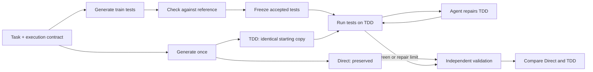

# Lab 4 · Part 2: Agentic TDD for an API and a GUI

Use executable tests to guide an agent's code repairs. You will run two registration tasks: a TypeScript HTTP API and a single-file browser GUI.

Each task compares **Direct**, the model's first implementation, with **TDD**, an identical copy repaired using model-generated tests. The same model handles every stage. Instructor validation measures both versions independently; its failures never enter the repair agent's context.

## Before class

Install **Node.js 24 LTS**, **npm 11 or later**, and a code editor such as VS Code. The Node.js installer includes npm. These instructions work on macOS and Windows.

Open **this Part 2 folder** in VS Code, then select **Terminal → New Terminal**. Run every command below from this folder, where `package.json` is located.

```bash
node -v
npm -v
npm ci
npm run setup:browsers
npm run check:setup
```

- `node -v` should show `v24.x.x`.
- `setup:browsers` installs the Chromium version required by Playwright.
- `check:setup` runs both actual demo commands using a local simulated model service, real HTTP servers, Vitest, and Chromium. It checks repair, final comparison, and invalid-test handling. It needs no API key and makes **no paid model calls**. Temporary output is removed after success; a failure prints its diagnostic directory.

Next, copy `.env.example` to `.env` using your editor's file explorer. Enter the API key supplied by your instructor:

```dotenv
base_url=https://api.arc-bench.com/v1
api_key=replace-with-your-api-key
model=deepseek-v4-flash
```

Keep `.env` private. Run the provider check:

```bash
npm run doctor
```

Wait for `[ok]`. This checks the configured endpoint, credentials, model response, and function calling. **Doctor and the two live demos use the real model API and may incur charges.** The offline setup check cannot establish provider availability.

## In class

Run one task at a time. Each command pauses after Acts 0–5. Read the output and press Enter to continue.

### 1. Registration API

```bash
npm run demo:api
```

The model implements `POST /api/register` using the standard `Request` and `Response` interfaces. A fixed adapter starts and stops the HTTP server. Generated Vitest tests exercise the public endpoint.

### 2. Registration GUI

```bash
npm run demo:gui
```

The model creates `index.html` with inline CSS and JavaScript. The command opens the reference, Direct, and TDD pages when it is time to inspect them. Return to the terminal after inspecting each page. Playwright tests run in separate browser contexts.

If your browser does not open automatically, use the localhost URL printed in the terminal. Keep the demo running while inspecting a page; its server stops when the command exits.

### What happens in each task?

| Act | What to observe |
| --- | --- |
| 0 | Read the task and understand the comparison. |
| 1 | Generate Direct and copy the exact same code to TDD. |
| 2 | Measure Direct using instructor validation. |
| 3 | Generate executable tests and check them against a reference implementation. |
| 4 | Run the accepted tests on TDD; let the agent repair the code using their feedback. |
| 5 | Measure TDD independently and compare it with Direct. |



Repairs are bounded: at most three implementation writes for API and two rounds for GUI. GUI tests that disagree with the reference are excluded and recorded. API test defects receive bounded test repair. If no valid train suite remains, implementation repair is skipped and the final comparison uses the unchanged baseline. Remaining train failures or reaching the repair limit are reported honestly; completing the workflow does not mean every check passes.

## Inspect your work

Your own run creates these files; the distributed lab starts without generated work or previous results:

```text
workspace/
  api/
    direct/register.ts
    train/register.test.ts
    tdd/register.ts
  gui/
    direct/index.html
    train/register.spec.ts
    tdd/index.html
runs/
  <run-id>/
    result.json
    raw/
    test-output/
    logs/
```

The next run replaces the current workspace for that scenario. `runs/` preserves your own prompts, generated code, tests, and diagnostic records. These directories and `.env` are ignored by Git.

Start reading the implementation here:

| File or folder | Role |
| --- | --- |
| `requirements/register_api.md`, `requirements/register_gui.md` | Public tasks |
| `prompts/contracts/` | Interfaces between generated code and the harness |
| `src/cli/demo.ts` | Connects the scenario to its servers and test runners |
| `src/run/orchestrator.ts` | Acts 0–5 and the bounded workflow |
| `src/agents/generate.ts` | Direct and train-test generation prompts |
| `src/agents/repair.ts` | Agent tools for code writes and train-test execution |
| `src/testing/` | Vitest/Playwright runners and their result interpretation |
| `src/validation/`, `validation/` | Independent instructor evaluation |

Discuss which behaviors improved, which remain incorrect, whether the train tests covered them, and how many requests and tokens the repairs required. Train Green and independent validation measure different things. Improvement is an observation, not a guaranteed outcome.

## Useful options and troubleshooting

```bash
# Watch automated reference, training, and validation tests in visible browsers.
npm run demo:gui -- --headed

# Show preview URLs without automatically opening a browser.
npm run demo:gui -- --no-open

# Run without classroom pauses.
npm run demo:api -- --no-interactive
npm run demo:gui -- --no-interactive --no-open

# Check the course code without model calls.
npm run typecheck
npm test
```

- **Wrong Node version:** install Node.js 24, reopen the terminal, and run `npm ci` again.
- **Missing Chromium:** rerun `npm run setup:browsers`. On Linux, use `npx playwright install --with-deps chromium` if system libraries are missing.
- **Missing `.env`:** create it beside `package.json`, using `.env.example` as the template.
- **Doctor fails:** check the three configuration values and share the error with the instructor, without sharing your API key.
- **A live demo stops before comparison:** check the printed error and its run directory. `npm run check:setup` distinguishes local setup problems from live-provider problems.

Generated application code and tests execute locally. Use the course environment and keep unrelated secrets out of it.
