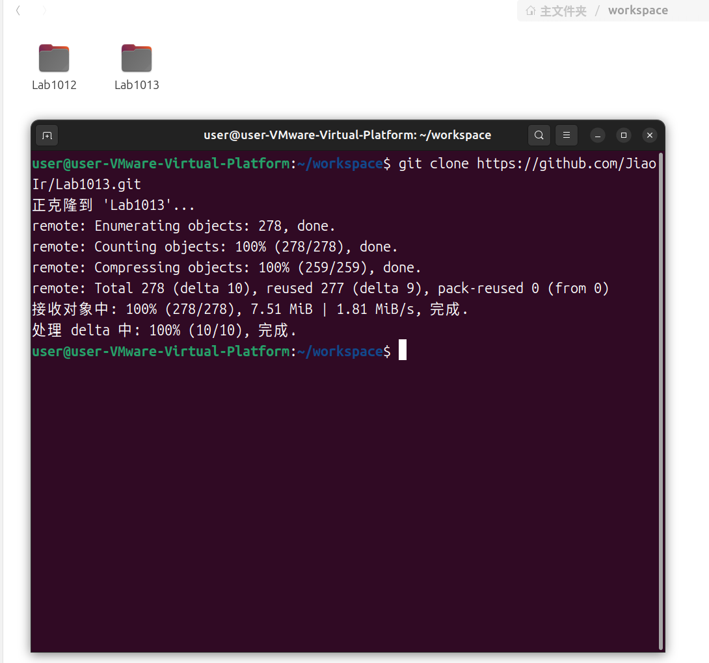
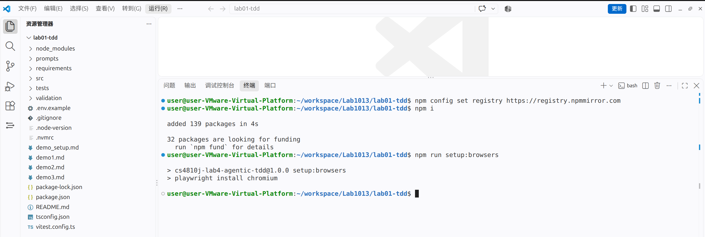
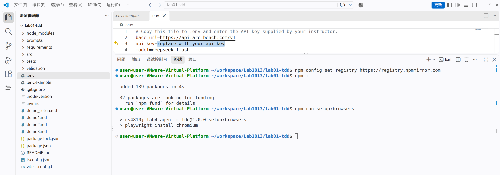
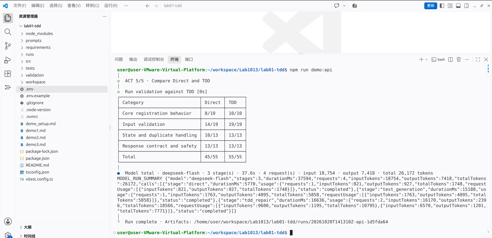
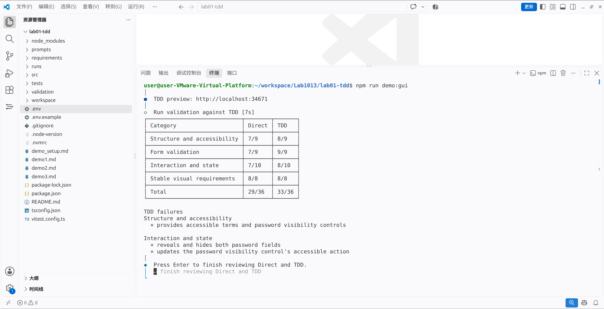
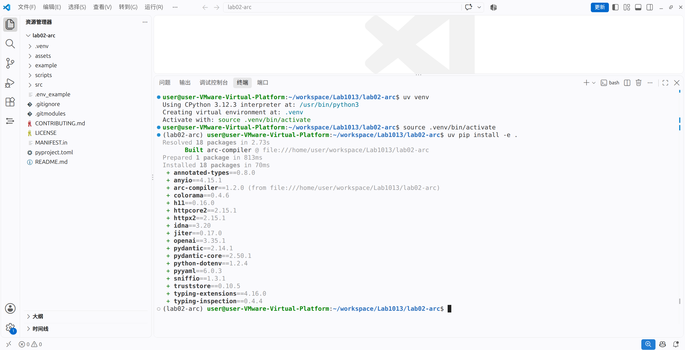
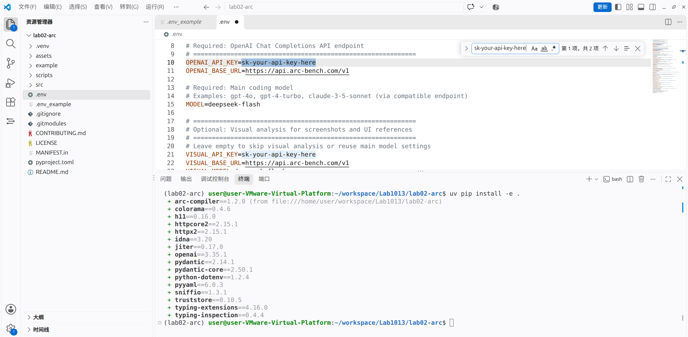
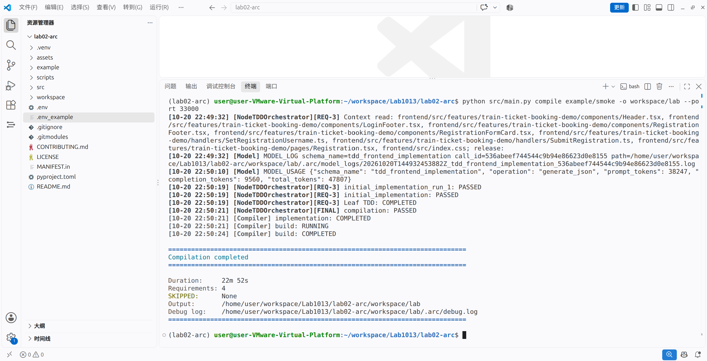
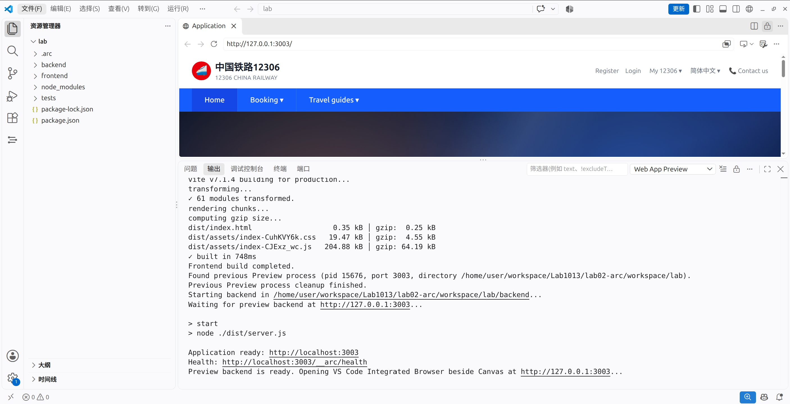

# 实验操作说明

## 实验材料获取

任选以下任一地址克隆实验仓库。

GitHub：

```bash
git clone https://github.com/JiaoIr/Lab1013.git
cd Lab1013
```

Gitee（中国大陆网络环境推荐）：

```bash
git clone https://gitee.com/JiaoIr/lab1013.git
cd lab1013
```



## 环境准备

使用提供的虚拟机环境可跳过本节。以下命令以 Linux / Bash 为例。

自行配置环境时，需安装 Git、VS Code、Node.js 24、npm 11+、Python 3.11+ 和 uv；Lab02 还需 pnpm 及 ARC Visualizer 扩展。

## Lab01 - 测试驱动

从仓库根目录执行：

```bash
cd lab01-tdd
code .
```

后续操作均在 VS Code 中进行，命令在集成终端执行。

```
npm config set registry https://registry.npmmirror.com
npm i
npm run setup:browsers
```



配置环境变量：

- 将 `.env.example` 复制为 `.env`。
- 将 `api_key` 的值替换为提供的 API Key。



### Part 1 - demo:api

```
npm run demo:api
```

运行过程中，按提示按回车键，无需输入其他内容。



### Part 2 - demo:gui

```
npm run demo:gui
```

运行过程中，按提示按回车键，无需输入其他内容。



## Lab02 - 需求编译

从仓库根目录执行（若当前在 `lab01-tdd` 中，先执行 `cd ..`）：

```bash
cd lab02-arc
code .
```

在 VS Code 的集成终端执行：

```bash
uv venv
source .venv/bin/activate
uv pip install -e .
```



配置环境变量：

- 将 `.env_example` 复制为 `.env`。
- 将 `OPENAI_API_KEY` 和 `VISUAL_API_KEY` 的值替换为提供的 API Key。



然后运行：

```
python src/main.py compile example/smoke -o workspace/lab --port 33000
```

预计耗时 15–30 分钟。



编译完成后，在 VS Code 中选择“文件 → 打开文件夹”，打开 `lab02-arc/workspace/lab` 目录。

按 `Ctrl+Shift+P` 打开命令面板，执行：

```
> ARC Visualizer: Open Web App Preview
```



预览结束后，手动关闭网页，或在命令面板执行：

```
> ARC Visualizer: Stop Web App Preview
```
